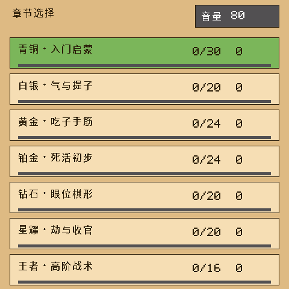
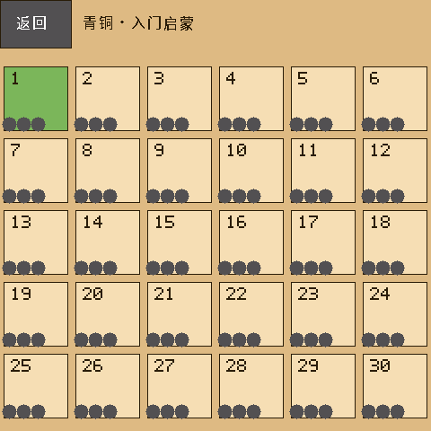
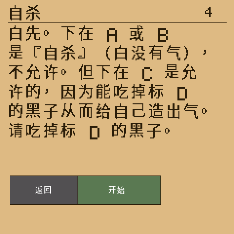
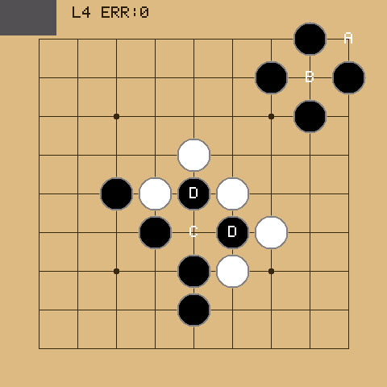
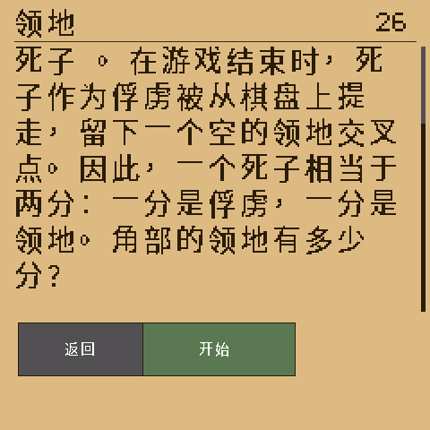
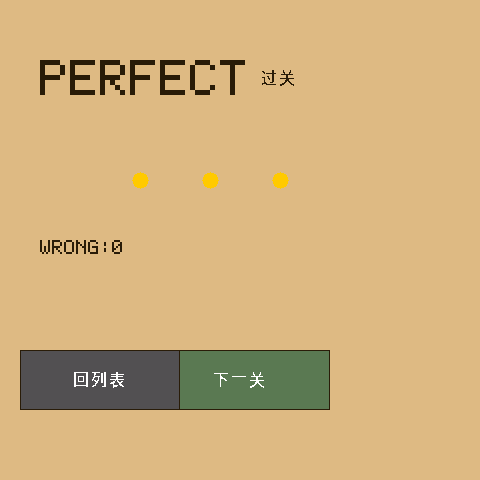
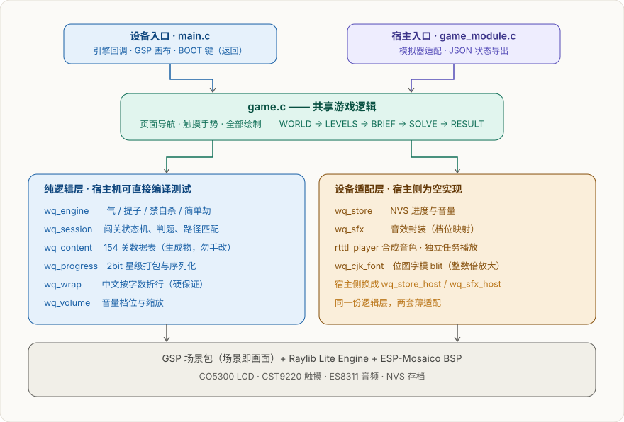

# weiqi_quest · 围棋闯关

> 一台掌上围棋陪练：9×9 棋盘、**7 章 154 关**，从「气与提子」一路闯到「劫与收官」。
> ESP-Mosaico / Raylib Lite Engine，480×480 触摸屏，30 FPS。

| 章节选择 | 关卡网格（全部开放） | 题面（2 倍字号） |
|---|---|---|
|  |  |  |

| 答题（盘上标 A/B/C/D） | 长题面可滚动 | 结算 |
|---|---|---|
|  |  |  |

---

> **关于本仓库**：这是 ESP-Mosaico 工作区里 `projects/weiqi-quest` 一个工程的源码快照。
> 下面命令里的 `python mosaico.py ...` 需要在**工作区根目录**执行 —— 工作区提供
> `mosaico.py` 入口、BSP（`submodule/esp-mosaico-bsp`）、引擎（`submodule/raylib-lite-engine`）
> 与 GSP（`weiqi-solution/dev/esp-gsp`）。本仓库只含该工程自身的源码、题库、字库管线、
> 宿主测试与文档，不含这些外部依赖，因此不能脱离工作区独立构建。

---

## 玩法

一局就是「读题 → 落子 → 结算」，五个页面循环：

| 页面 | 做什么 |
|---|---|
| **章节选择** | 7 章列表，显示每章通关数与总星数；右上角按钮循环切音量（关 → 20 → … → 100 → 关） |
| **关卡网格** | 本章关卡一屏铺开，**154 关全部开放**，没有解锁链；已通关的显示星级圆点 |
| **题面** | 题面正文按 **2 倍字号**排版（一行 12 字）。最长的几关会超一屏，**按住题面上下拖动可滚动**，右侧有滚动位置指示 |
| **答题** | 触摸交叉点落子（自动吸附）；选择题点底部选项条；终局类点任意处确认 |
| **结算** | 星级 + 错误数；「下一关」直接进下一关，「回列表」回本章关卡 |

**三种题型**（共 154 关）：

- **落子解题** 119 关 —— 盘上标好 A/B/C/D，题面说「请吃掉标 D 的黑子」，落对即过关
- **选择题** 32 关 —— 底部 3~5 个选项条
- **终局** 3 关 —— 停一手 / 提死子 / 完成确认

**评级**：走错 0 次 3 星、1 次 2 星、2 次及以上 1 星。走错不是结束 —— 棋盘复位重来，错误数记着。

### 操作

- **触摸**：落子 / 选关 / 按按钮；题面页支持上下拖动滚动
- **BOOT 键**（USB-C 口左侧）= **返回上一层**：关卡页 → 章节页、题面 → 关卡列表、
  答题中 → 放弃本关、结算 → 关卡列表；已经在章节页时不动作

### 内容

| 章 | 关数 | 主题 |
|---|---|---|
| 青铜 · 入门启蒙 | 30 | 气、提子、禁自杀、基本着法 |
| 白银 · 气与提子 | 20 | 紧气、长气、双打 |
| 黄金 · 吃子手筋 | 24 | 打吃、征子、枷吃 |
| 铂金 · 死活初步 | 24 | 真假眼、急所 |
| 钻石 · 眼位棋形 | 20 | 棋形、要点、连接与切断 |
| 星耀 · 劫与收官 | 20 | 劫争、劫材、停一手 |
| 王者 · 高阶战术 | 16 | 综合战术与终局判断 |

存档写在 NVS（命名空间 `weiqi`），重启从上次玩到的那一章继续；音量档位独立持久化。

---

## 实现



**一份 C 逻辑层，两套薄适配。** [game.c](main/game.c) 里的页面导航、触摸手势、全部绘制，
以及 `main/wq/` 下的规则引擎、闯关状态机、题库、存档、折行，都不依赖 ESP-IDF ——
所以固件和电脑模拟器编的是**同一份代码**，逻辑在电脑上就能跑测试，不用上机。

几个值得一说的设计：

- **判题是「路径匹配」而不是「局面比对」**：每关带一条或多条正解着法序列（从玩家先手开始），
  玩家每一手必须延续**某一条**还没走完的候选路径；走完任一条即过关。对手应手取「第一条仍然
  匹配的候选路径」的下一手。占位 / 自杀 / 劫回提在规则引擎层就落不下去 —— **不算错误**，
  也不复位，光标原地不动。
- **规则引擎** `wq_engine.c` 实现气 / 提子 / 禁自杀 / 简单劫，提子判定先于自杀判定，
  所以「至少提一子」的落子永远合法。
- **中文显示**：raylib 的 `DrawText` 只有 5×7 ASCII，中文走一张 **16×16 位图字模表**
  （[wq_cjk_font.c](main/wq_cjk_font.c) 逐像素 blit），ASCII 与中文在一行里分段混排；
  题面正文按整数倍放大到 2 倍，每像素画成 2×2 方块，笔画是实的、不发虚。
  中文没有空格，所以折行是自己按字数算的（[wq_wrap.c](main/wq/wq_wrap.c)，带硬保证）。
- **音效全部合成**：8 种 RTTTL 短旋律（落子 / 提子 / 对 / 错 / 返回 / 过关…），
  跑在独立任务里，不依赖任何音频素材文件。
- **触摸与按键都走同一条路**：BOOT 键回调只往引擎事件队列投一条事件，
  状态变更加在游戏任务上做 —— 和触摸输入同一条路径，不跨任务改同一份 state。

### 目录结构

```
main/
  main.c              设备入口：引擎回调、GSP 画布、BOOT 键
  game_module.c       宿主入口：模拟器适配、JSON 状态导出
  game.c / game.h     共享游戏逻辑：页面导航、触摸手势、绘制
  game_config.h       工程标识与显示/节拍常量
  wq_cjk_font.c/.h    中文位图字模 blit（含整数倍放大）
  wq_cjk_glyph_data.h 字模表（生成物，勿手改）
  wq/
    wq_engine.c       围棋规则：气 / 提子 / 禁自杀 / 简单劫
    wq_session.c      闯关状态机：导航、判题、路径匹配
    wq_content.c/.h   154 关数据表（生成物，勿手改）
    wq_progress.c     2bit 星级打包与序列化
    wq_wrap.c         中文按字数折行
    wq_volume.c       音量档位与缩放
    wq_store.c        NVS 存档（宿主侧换成 wq_store_host.c）
    wq_sfx.c / rtttl_player.c   ES8311 音效（宿主侧换成 wq_sfx_host.c）
tools/weiqi/          题库源与生成器、校验脚本、模拟器回放脚本
tests/                宿主逻辑测试（7 套，秒级）
docs/                 上机体检报告与截图
```

---

## 构建与运行

工程目录名是 **`weiqi-quest`**（连字符），与固件里的 `GAME_NAME`（`weiqi_quest`）不同，
别写成下划线。

### 电脑上跑（不需要硬件）

```sh
# 交互式模拟器（用与固件相同的 C 渲染器）
python mosaico.py game sim --project projects/weiqi-quest

# 无头跑 N 帧：上机前最划算的一道闸，30 秒内能抓到编译错误与版式/交互问题
python mosaico.py game sim --project projects/weiqi-quest --headless --frames 120

# 回放脚本驱动（tools/weiqi/replay-*.json），用于验证固定交互路径
python mosaico.py game sim --project projects/weiqi-quest \
  --headless --frames 20 --scenario tools/weiqi/replay-scroll-2x.json \
  --state-output /tmp/state.json
```

### 宿主逻辑测试（秒级）

```sh
powershell -ExecutionPolicy Bypass -File tests/build_host_tests.ps1
```

7 套：规则引擎（含全题库 134 条正解路径逐手重放）、题库完整性、进度存档、
闯关状态机（含全题库通关）、折行、**题面版式预算**、保留了但未接 UI 的 AI 选点。

### 固件

```sh
python mosaico.py game build --project projects/weiqi-quest
python mosaico.py iris system-update --project projects/weiqi-quest
```

首次装到空白设备上要先 `python mosaico.py recover --project projects/weiqi-quest`。

> **写入失败重试请加 `--skip-build`**：`system-update` 每次调用都会整包重编（约 28 分钟），
> 但只要 `build/weiqi_quest-system-update.irisfw` 已存在，就可以复用它，几秒钟完成写入。
> **注意：这只适用于"源码没改、重写同一份包"；只要改过源码就必须重新构建。**
> 每条设备命令前后记得 `iris reconcile`（设备所有权记录会残留，表现为"设备被占用"）。

---

## 生成物与校验

`main/wq/wq_content.c|h`（题库 C 表）与 `main/wq_cjk_glyph_data.h`（字模表）都是**生成物**。
改了 `tools/weiqi/levels.txt`（题面/坐标）或界面文案之后必须重跑：

```sh
python tools/weiqi/gen_content.py     # 题库 -> C 表
python tools/weiqi/gen_cjk_font.py    # 字库 -> 位图表
```

两个生成器都支持 `--check`（过期就非零退出）。一条命令跑完全部静态检查 + 宿主测试：

```sh
bash tools/weiqi/validate.sh
```

**为什么要这么较真**：字模表的字符清单是从题库和界面文案里推导的，一旦漏字，
设备上那几个字会**整块消失**（不是显示成方框，是直接没有）；题面版式的「一屏放几行、
要不要滚」也是算出来的 —— 改字号、改行宽或加长题面都会让它失效，所以
`tests/test_wq_brief_layout.c` 把这些结论钉住了。

---

## 已知限制

- **掌上设备定位**：无网络功能，AI 选点代码保留但未接进 UI（当前是纯闯关练习）。
- **盘面标记的字号**：盘上的 A/B/C/D 沿用 16px ASCII 字体，在 48px 的交叉点里偏小；
  真要更醒目需要单独做一套更大的标记字形。
- **raylib-lite 游戏没有屏幕镜像后端**，所以 `iris screenshot` 会报
  `empty frame description` —— 这是已知现象、不是应用故障，
  验收改看日志（`first frame presented`、稳定的 `logic=`/`display=` 帧统计、`crash_count=0`）加目视。
- `tools/weiqi/validate.sh` 需要在有 bash 的环境里跑（Windows 上 Git Bash 可用）；
  它内部会转而调用 `tests/build_host_tests.ps1`。

更细的排查记录与验收证据见 [docs/上机体检报告.md](docs/上机体检报告.md)。

### 感谢

https://linux.do 社区支持